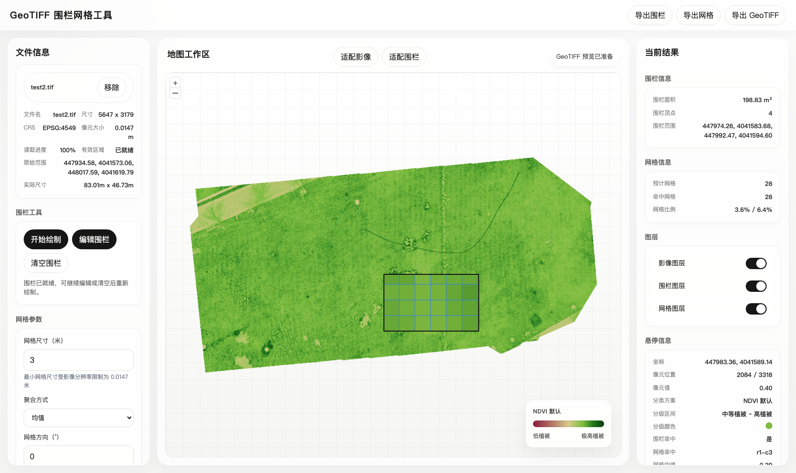
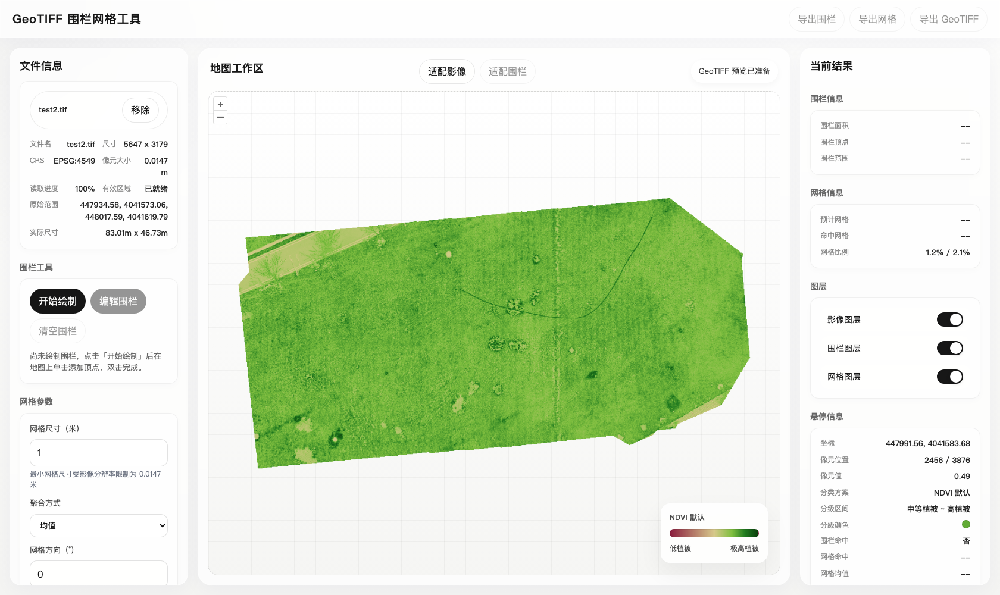
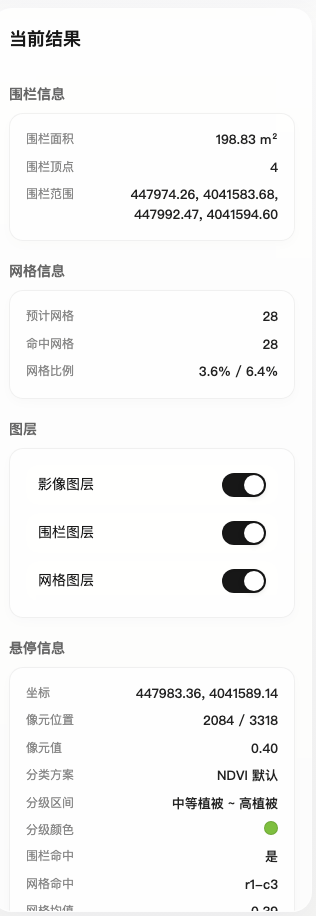
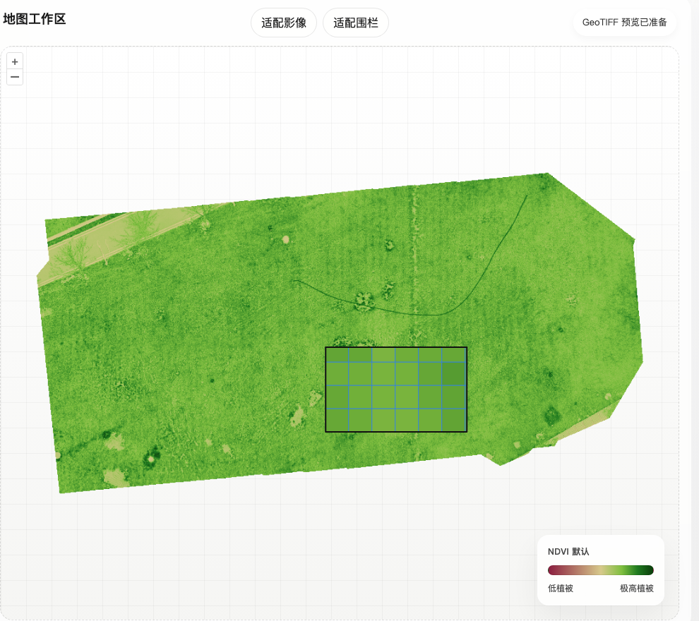

# GeoTIFF Fence Grid Tool

[中文](README.md) · **English**

A browser-based tool for precision-agriculture operations: load a GeoTIFF scene, draw an electronic fence on the map, generate a spatial grid, aggregate pixel values per grid cell, and export both GeoJSON and a clipped prescription GeoTIFF that can be handed straight to field machinery.


> The user interface is currently Chinese-only; the screenshots below show the actual application.

## Table of contents

- [Screenshots](#screenshots)
- [Highlights](#highlights)
- [Typical workflow](#typical-workflow)
- [Tech stack](#tech-stack)
- [Getting started](#getting-started)
- [Available scripts](#available-scripts)
- [Project layout](#project-layout)
- [Feature modules](#feature-modules)
- [Module relationships](#module-relationships)
- [Performance design](#performance-design)
- [Testing](#testing)
- [FAQ](#faq)
- [Roadmap](#roadmap)
- [License](#license)

## Screenshots

### Full workflow: fence + grid + aggregated results



Grid size, rotation and classification are configured on the left; the map renders the scene, the fence outline and the colour-coded grid; the right panel reports fence area, hit-cell count and the hovered pixel/grid mean value.

### Start screen


| Scene loaded | Results and hover info |
| --- | --- |
|  |  |

<details>
<summary>More screenshots</summary>



</details>

## Highlights

- **GeoTIFF loading and inspection**
  - Reads large GeoTIFF files locally, with no server upload
  - Extracts CRS, resolution, bounding box and band count automatically
  - Staged loading: renders the image preview first, then builds the valid-data (nodata) mask in the background
- **Electronic fence drawing and editing**
  - Free-form polygon fences that can be edited, cleared and redrawn
  - Fences are clipped to the image extent and the valid-data region, with inline validation feedback
  - Reports fence area, vertex count and bounding box
- **Spatial grid preview and aggregation**
  - Splits the fence into a grid in real time, with configurable cell size and rotation
  - Enforces a minimum cell size derived from image resolution to prevent over-dense grids
  - Selects cells by fence-centre hit rule and aggregates the mean of valid pixels in the primary band
  - Very large grids fall back to a sampled geometric preview (50k-cell cap) instead of crashing the renderer
  - The grid preview, hover readout and exported data all share one aggregation result
- **Classification layers and variable-rate application**
  - Rule-based and gradient classification modes for single-band imagery
  - Multiple classification schemes can be created, duplicated, switched and toggled; a default NDVI scheme ships with the app
  - Each rule carries a colour, a label and an application rate (`applicationRate`)
  - Summarises covered area and estimated total application per scheme
- **Background computation (Web Worker)**
  - Preview re-colouring, validity-mask extraction and grid aggregation run off the main thread
  - Falls back to the main thread automatically when Workers are unavailable
  - rAF-throttled pointer handling, cached grid styles and O(1) spatial lookup keep the map responsive
- **Data export**
  - **GeoJSON**: fence geometry; grid geometry plus aggregation attributes, writing the configured rate into each cell's `fertilizerAmount`
  - **GeoTIFF**: clips the source image to the fence, writes grid aggregation values into pixels and fills misses with NoData; when classification rules are enabled, bands are promoted to `Float32` and an extra `Float32` prescription band stores the per-pixel `applicationRate` for downstream controllers

## Typical workflow

1. Pick a GeoTIFF file in the left panel; the app parses metadata and renders a map preview.
2. Click "Start drawing", then single-click to add vertices and double-click to close the fence. The fence is clipped to the valid-data region automatically.
3. Configure cell size and rotation (optionally switch classification scheme and application rates); the grid preview and pixel aggregation update in real time.
4. The map and the right panel show grid statistics, classification results and estimated application; hover the map for pixel value, classification range and grid mean.
5. Use the top bar to export fence GeoJSON, grid GeoJSON or the clipped prescription GeoTIFF.

## Tech stack

| Area | Choice |
| --- | --- |
| Framework | React 19 + TypeScript + Vite 6 |
| State management | Zustand 5 |
| Map rendering | OpenLayers 10 |
| Raster parsing | geotiff.js |
| Spatial computation | Turf.js + Proj4js |
| Testing | Vitest + Testing Library |

## Getting started

Requirements: Node.js 18+ and pnpm.

```bash
# install dependencies
pnpm install

# start the dev server
pnpm dev
```

Then open <http://localhost:5173>. The dev server binds to the loopback interface only; add `--host` yourself if you need LAN access.

Prepare a local GeoTIFF file — a single- or multi-band image with a `GDAL_NODATA` tag or a zero-valued background both work — and load it via "Select TIFF file" in the left panel.

## Available scripts

| Command | Description |
| --- | --- |
| `pnpm dev` | Start the Vite dev server |
| `pnpm build` | Type-check (`tsc --noEmit`) and build for production |
| `pnpm preview` | Preview the production build locally |
| `pnpm test` | Run the full Vitest suite |

## Project layout

```text
src/
├── app/
│   ├── layout/               # three-column shell (TopBar / LeftPanel / RightPanel / overlays)
│   │   └── right-panel/      # right-panel widgets (classification, hover card, inputs)
│   ├── styles/               # global and layout styles (base / layout / components)
│   ├── App.tsx               # application root
│   └── main.tsx              # render entry
├── features/
│   ├── map/                  # map instance, raster layers, loading pipeline, interaction hooks
│   ├── grid/                 # grid parameters, preview and aggregation state
│   ├── fence/                # fence drawing, editing and validation state
│   ├── export/               # GeoJSON / GeoTIFF export pipeline
│   ├── project/              # project snapshot serialisation and local draft persistence
│   └── loading/              # global loading state
├── shared/
│   ├── geo/                  # geospatial computation
│   │   ├── crs.ts            # CRS detection and projection transforms
│   │   ├── fence.ts          # fence clipping, validation and valid-region outline
│   │   ├── grid.ts           # grid generation
│   │   ├── gridAggregation.ts# per-cell pixel aggregation
│   │   ├── gridLookup.ts     # grid spatial index (O(1) lookup)
│   │   ├── geotiffExport.ts  # clipped export and aggregation write-back
│   │   ├── geotiffWriter.ts  # GeoTIFF writer
│   │   ├── raster*.ts        # raster parsing, classification, colour, IO, preview
│   │   ├── applicationRate.ts# application-rate mapping
│   │   └── metricTransform.ts# metric-space transforms
│   ├── hooks/                # shared React hooks
│   ├── types/                # global type definitions
│   └── workers/              # Web Worker computation scripts
tests/                        # unit and component tests
docs/superpowers/             # design and implementation notes
docs/images/                  # README screenshots
```

## Feature modules

### 1. Raster intake

- **Responsibility**: file selection, metadata parsing, preview generation and valid-region extraction — the entry point of the whole pipeline.
- **Capabilities**
  - Reports file name, dimensions, CRS, cell size, band count and bounding box
  - Produces the preview first and extracts the validity mask asynchronously to shorten time-to-first-paint
  - Tracks read progress, loading phase, error state and pointer coordinates
- **Implementation**
  - [rasterStore.ts](src/features/map/rasterStore.ts)
  - [useRasterLoader.ts](src/features/map/useRasterLoader.ts)
  - [rasterIo.ts](src/shared/geo/rasterIo.ts)
  - [rasterPreview.ts](src/shared/geo/rasterPreview.ts)

### 2. Map workspace

- **Responsibility**: map instantiation, layer rendering, viewport fitting and hover feedback — the main interaction surface.
- **Capabilities**
  - Renders raster, fence and grid layers with OpenLayers, including layer visibility toggles
  - Provides "fit to image" and "fit to fence" view actions
  - Shows hover coordinates, pixel position/value, classification result, fence and grid hit state
  - Renders the classification legend (rule list or gradient ramp)
- **Implementation**
  - [MapView.tsx](src/features/map/MapView.tsx)
  - [useMap.ts](src/features/map/useMap.ts)
  - [mapUiStore.ts](src/features/map/mapUiStore.ts)
  - [mapUtils.ts](src/features/map/mapUtils.ts)

### 3. Fence drawing and clipping

- **Responsibility**: fence drawing, editing, validation, summary statistics and extent clipping, so downstream analysis uses a correct extent.
- **Capabilities**
  - Draws and edits polygon fences on the map
  - Computes fence area, bounding box and vertex count
  - Clips fences to the image extent or the valid-data region and traces the valid-region outline
  - Supplies one shared spatial extent for hit testing, export bounds and grid generation
- **Implementation**
  - [fenceStore.ts](src/features/fence/fenceStore.ts)
  - [fence.ts](src/shared/geo/fence.ts)

### 4. Grid generation and aggregation

- **Responsibility**: builds the grid over the fence and aggregates the pixels inside each cell — the analytical core.
- **Capabilities**
  - Configurable cell size, rotation and aggregation mode (mean / max / min)
  - Selects cells by the fence-centre hit rule
  - Reports per-cell mean and valid-pixel count
  - Samples the geometry preview for very large grids to keep rendering tractable
- **Implementation**
  - [gridStore.ts](src/features/grid/gridStore.ts)
  - [grid.ts](src/shared/geo/grid.ts)
  - [gridAggregation.ts](src/shared/geo/gridAggregation.ts)
  - [gridLookup.ts](src/shared/geo/gridLookup.ts)

### 5. Classification and prescription configuration

- **Responsibility**: classification colouring, rule configuration and application-rate mapping for single-band imagery.
- **Capabilities**
  - Gradient and rule-based classification modes
  - Multiple schemes with create, duplicate, switch and visibility controls
  - Per-rule colour, label and `applicationRate`
  - Aggregated covered area and estimated total application per scheme
- **Implementation**
  - [RightPanel.tsx](src/app/layout/RightPanel.tsx)
  - [classificationUtils.ts](src/app/layout/right-panel/classificationUtils.ts)
  - [rasterClassification.ts](src/shared/geo/rasterClassification.ts)
  - [applicationRate.ts](src/shared/geo/applicationRate.ts)

### 6. Export

- **Responsibility**: turns fences, grids and clipped analysis results into standard geographic files.
- **Capabilities**
  - Fence GeoJSON export
  - Grid GeoJSON export with aggregation values and `fertilizerAmount`
  - Clipped GeoTIFF export with aggregation written back into pixels
  - Prescription band appended in rule-based mode for downstream machinery
- **Implementation**
  - [exportGeoJson.ts](src/features/export/exportGeoJson.ts)
  - [exportGeoTiff.ts](src/features/export/exportGeoTiff.ts)
  - [geotiffExport.ts](src/shared/geo/geotiffExport.ts)
  - [geotiffWriter.ts](src/shared/geo/geotiffWriter.ts)

### 7. Project snapshots and drafts

- **Responsibility**: serialises fence, grid, classification and view state into a reproducible project snapshot and keeps a local draft.
- **Capabilities**
  - Encodes fence, grid parameters, classification schemes, layer visibility and view state as `ProjectSnapshotV1`
  - Serialises, validates and restores snapshots, including `TTOT1:`-prefixed snapshots embedded in image files
  - Compares source-file fingerprints (name, size, mtime) to check a draft against the current image
  - Keeps drafts isolated per tab and degrades to no persistence on storage errors (quota, private mode)
- **Implementation**
  - [projectSnapshot.ts](src/features/project/projectSnapshot.ts)
  - [applyProjectSnapshot.ts](src/features/project/applyProjectSnapshot.ts)
  - [draftStorage.ts](src/features/project/draftStorage.ts)
  - [readEmbeddedSnapshot.ts](src/features/project/readEmbeddedSnapshot.ts)

### 8. Background computation and performance

- **Responsibility**: moves heavy computation off the main thread and bounds front-end performance risk with caching and throttling.
- **Capabilities**
  - Offloads preview generation, validity-mask extraction and grid aggregation to a Web Worker
  - Falls back to main-thread execution when Workers are unavailable
  - Uses rAF throttling, style caches and spatial indexes to cut interaction cost
  - Keeps large images and dense grids usable
- **Implementation**
  - [rasterCompute.worker.ts](src/shared/workers/rasterCompute.worker.ts)
  - [useRasterLoader.ts](src/features/map/useRasterLoader.ts)
  - [useMap.ts](src/features/map/useMap.ts)
  - [debugLogger.ts](src/features/map/debugLogger.ts)

### 9. Shell and global state

- **Responsibility**: three-column layout, top-level action wiring, loading feedback and global state glue.
- **Capabilities**
  - Left panel hosts file, fence and grid configuration
  - Centre map hosts image and spatial-result visualisation
  - Right panel hosts statistics, layer control, hover info and classification configuration
  - Top bar unifies fence, grid and GeoTIFF export actions
- **Implementation**
  - [App.tsx](src/app/App.tsx)
  - [TopBar.tsx](src/app/layout/TopBar.tsx)
  - [LeftPanel.tsx](src/app/layout/LeftPanel.tsx)
  - [RightPanel.tsx](src/app/layout/RightPanel.tsx)
  - [loadingStore.ts](src/features/loading/loadingStore.ts)

## Module relationships

- `app` — page layout and interaction entry wiring.
- `features` — per-domain state and flow control.
- `shared/geo` — geospatial computation, GeoTIFF handling and classification algorithms (the capability layer).
- `shared/types` — fence, grid, raster and other core data contracts shared across modules.
- `shared/workers` — offloadable pure computation sharing the same type contracts as the main thread.
- `tests` — export, spatial computation, state management and main UI interactions.

## Performance design

| Technique | Problem it solves |
| --- | --- |
| Staged loading (preview first, mask async) | Long time-to-first-paint on large files |
| Web Worker offload | Preview re-colouring, mask building and grid aggregation blocking the main thread |
| rAF-throttled pointer handling | High-frequency `pointermove` causing excess re-renders |
| Grid spatial index (`gridLookup`) | Hover hit-testing from linear scan to O(1) |
| Grid style cache + batch `addFeatures` | Repeated style creation and per-feature rendering for dense grids |
| Grid preview sampling cap (50k cells) | Renderer crashes on very large grids |
| Minimum cell size from image resolution | Over-dense grids and wasted computation from bad parameters |
| `RasterSession` reuse | Repeated reads of the same image |
| `useMemo`-cached right-panel statistics | Rule statistics recomputed on every render |

## Testing

```bash
# run the full suite
pnpm test
```

Coverage spans spatial computation (CRS, fence, grid, aggregation, metric transforms, GeoTIFF writer and export), state management (raster, grid, UI), project snapshots and drafts, and main UI interactions (left/right panels, top bar, map view, export controls).

CI ([.github/workflows/ci.yml](.github/workflows/ci.yml)) runs `pnpm install --frozen-lockfile`, `pnpm build` and `pnpm test` on Node.js 22 with pnpm 10.

## FAQ

**The fence reports "the fence must fall inside the valid image data".**
Draw the fence inside the valid-data region, avoiding the transparent/nodata border. Use "fit to image" first, then draw inside the visible valid area.

**The grid is empty or uncoloured.**
Check whether the cell size is much larger than the fence and whether the fence overlaps valid data at all. A hover readout of `--` for the grid hit means no cell covers that point.

**Why is the exported GeoTIFF `Float32`?**
Once classification rules are enabled the export must carry the application-rate band, so bands are promoted to `Float32`. Without classification rules the original data type is preserved where possible.

**The browser stutters or the page becomes unresponsive.**
Check image size and grid density first. The current version samples very large grids for preview only, but extreme parameter combinations should still be avoided.

## Roadmap

### Done

- [x] Vite + React + TypeScript + Vitest foundation
- [x] Three-column workspace and map integration
- [x] GeoTIFF reading, metadata parsing and OpenLayers rendering
- [x] Fence drawing, editing, clipping and GeoJSON export
- [x] Real-time spatial grid preview and aggregation
- [x] Classification layers (rules/gradient) with application-rate estimation
- [x] One aggregation result driving both map preview and GeoTIFF export
- [x] Multi-CRS detection and projection transforms
- [x] Grid rotation control and fence clipping
- [x] `RasterSession` reuse to avoid repeated reads
- [x] Hover cost optimisation (rAF throttling, unified Zustand subscription sync)
- [x] Web Worker background computation (preview, mask, grid aggregation)
- [x] Minimum cell size derived from image resolution
- [x] Project snapshot serialisation/restore and local draft persistence

### In progress / planned

- [ ] Multi-fence queue and batch export
- [ ] Chunked extraction and memory optimisation for very large files
- [ ] Project file import/export wired into the UI
- [ ] Vegetation indices (NDVI / GNDVI / NDRE / SAVI / EVI / VARI) and classification histogram wired into the UI

## License

Released under the [MIT License](LICENSE). Copyright (c) 2026 ttot contributors.
