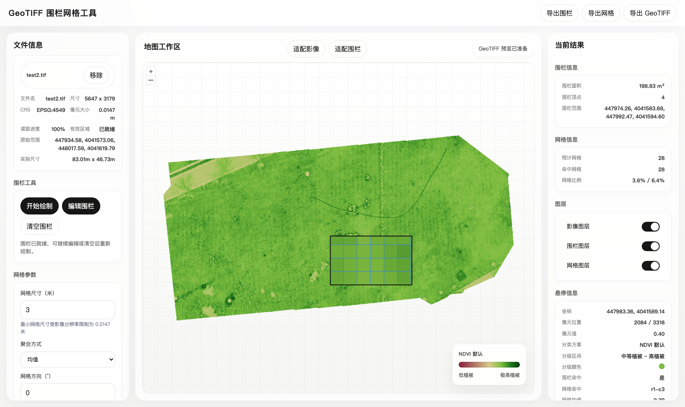
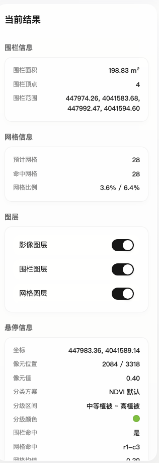
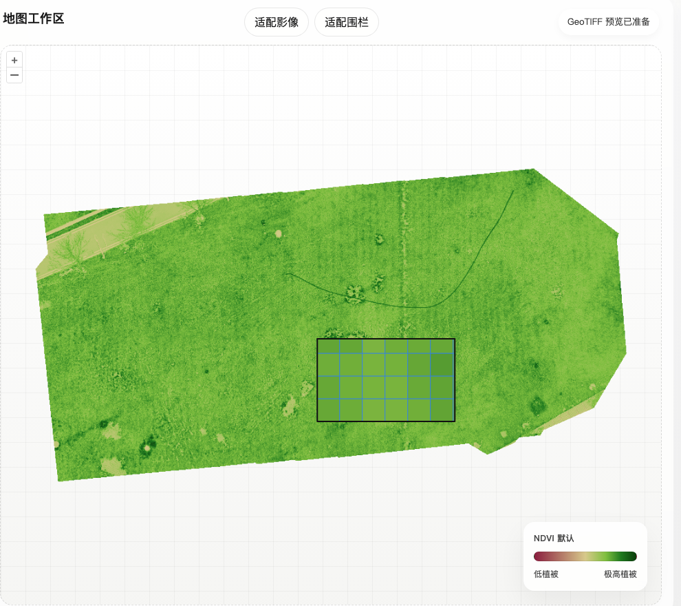

# GeoTIFF 围栏网格工具

**中文** · [English](README.en.md)

面向精准农业作业的浏览器端 Web 工具：加载 GeoTIFF 遥感影像，在地图上绘制电子围栏、生成空间网格、按网格聚合像元值，并导出可直接下发到农机终端的 GeoJSON 与处方 GeoTIFF。


## 目录

- [界面预览](#界面预览)
- [核心特性](#核心特性)
- [典型业务流程](#典型业务流程)
- [技术栈](#技术栈)
- [快速启动](#快速启动)
- [可用脚本](#可用脚本)
- [项目结构](#项目结构)
- [功能模块介绍](#功能模块介绍)
- [模块关系说明](#模块关系说明)
- [性能设计](#性能设计)
- [测试](#测试)
- [常见问题](#常见问题)
- [开发路线](#开发路线)
- [许可](#许可)

## 界面预览

### 完整工作流：围栏 + 网格 + 聚合结果



左侧配置网格尺寸、方向与分类方案，中间地图同时呈现影像、围栏轮廓与网格着色，右侧实时给出围栏面积、命中网格数和悬停像元/网格均值。

### 启动界面


| 影像加载完成 | 结果与悬停信息 |
| --- | --- |
|  |  |

<details>
<summary>查看更多截图</summary>



</details>

## 核心特性

- **GeoTIFF 加载与解析**
  - 本地读取大尺寸 GeoTIFF 文件，无需上传服务器
  - 自动提取 CRS、分辨率、边界框、波段数等元信息
  - 分阶段加载：优先渲染影像预览，后台异步提取有效数据区域（nodata mask）
- **电子围栏绘制与编辑**
  - 地图上自由绘制多边形围栏，支持编辑、清空与重新绘制
  - 围栏自动裁剪到影像边界与有效数据范围内，并给出校验提示
  - 输出围栏面积、顶点数、边界范围等摘要信息
- **空间网格预览与聚合**
  - 按围栏物理尺寸实时划分网格，支持自定义网格尺寸与旋转角度
  - 基于影像分辨率自动限制最小网格尺寸，防止过密划分
  - 以围栏中心命中规则筛选有效网格，统计命中网格的主波段有效像元均值
  - 超大网格仅做几何采样预览（50k 单元格上限），避免地图渲染崩溃
  - 网格预览、悬停信息与导出结果使用同一份聚合数据，三者保持一致
- **栅格分类图层与变量施肥配置**
  - 针对单波段影像提供规则分段与渐变色两种分类渲染模式
  - 支持多套分类方案的新建、复制、切换与显示控制，内置 NDVI 默认方案
  - 每条规则可配置颜色、标签与施药/施肥用量（`applicationRate`）
  - 按分类结果汇总覆盖面积与预计总用量
- **后台计算加速（Web Worker）**
  - 预览重着色、有效数据掩码生成、网格聚合等重计算 offload 到 Worker
  - Worker 不可用时自动回退主线程执行，保证兼容性
  - 指针移动使用 rAF 节流、网格样式缓存与 O(1) 空间查找，保持地图交互流畅
- **数据导出**
  - **GeoJSON**：导出围栏几何；导出网格几何与聚合属性，配置了分类规则时把对应用量写入每个网格的 `fertilizerAmount`
  - **GeoTIFF**：按围栏裁剪原始影像，将网格聚合值写入对应像元，未命中区域填充 NoData；启用分类规则时波段强制转为 `Float32`，并追加一个 `Float32` 处方波段存储每个像元的 `applicationRate`，便于下游处方机直接读取

## 典型业务流程

1. 在左侧面板选择 GeoTIFF 文件，系统解析元信息并生成地图预览。
2. 点击「开始绘制」，在地图上单击添加顶点、双击闭合围栏；围栏自动裁剪到有效数据范围。
3. 配置网格尺寸与方向（可选：切换分类方案与施肥用量），系统实时生成网格预览并完成像元聚合。
4. 地图与右侧面板同步展示网格统计、分类结果与处方量估算；悬停查看像元值、分类区间与网格均值。
5. 通过顶栏导出围栏 GeoJSON、网格 GeoJSON 或裁剪后的处方 GeoTIFF。

## 技术栈

| 分类 | 选型 |
| --- | --- |
| 框架 | React 19 + TypeScript + Vite 6 |
| 状态管理 | Zustand 5 |
| 地图渲染 | OpenLayers 10 |
| 栅格解析 | geotiff.js |
| 空间计算 | Turf.js + Proj4js |
| 测试 | Vitest + Testing Library |

## 快速启动

环境要求：Node.js 18+、pnpm。

```bash
# 安装依赖
pnpm install

# 启动开发服务器
pnpm dev
```

默认访问 <http://localhost:5173>。开发服务器仅监听本机回环地址；如需局域网访问，可自行追加 `--host`。

准备一个本地 GeoTIFF 文件（含 `GDAL_NODATA` 或 0 值背景的单波段/多波段影像均可），在左侧「文件信息」中点击「选择 TIFF 文件」加载。

## 可用脚本

| 命令 | 说明 |
| --- | --- |
| `pnpm dev` | 启动 Vite 开发服务器 |
| `pnpm build` | 类型检查（`tsc --noEmit`）+ 生产构建 |
| `pnpm preview` | 本地预览生产构建产物 |
| `pnpm test` | 运行全部 Vitest 测试 |

## 项目结构

```text
src/
├── app/
│   ├── layout/               # 三栏布局（TopBar / LeftPanel / RightPanel / 浮层）
│   │   └── right-panel/      # 右侧面板子模块（分类方案、悬停信息、输入控件）
│   ├── styles/               # 全局与布局样式（base / layout / components）
│   ├── App.tsx               # 应用根组件
│   └── main.tsx              # 渲染入口
├── features/
│   ├── map/                  # 地图实例、栅格图层、加载链路与交互钩子
│   ├── grid/                 # 网格参数、预览与聚合状态
│   ├── fence/                # 围栏绘制、编辑与校验状态
│   ├── export/               # GeoJSON / GeoTIFF 导出链路
│   ├── project/              # 工程快照序列化与本地草稿持久化
│   └── loading/              # 全局加载状态
├── shared/
│   ├── geo/                  # 地理空间计算
│   │   ├── crs.ts            # 坐标系检测与投影转换
│   │   ├── fence.ts          # 围栏裁剪、校验与有效区外轮廓
│   │   ├── grid.ts           # 网格生成
│   │   ├── gridAggregation.ts# 网格像元聚合
│   │   ├── gridLookup.ts     # 网格空间索引（O(1) 查找）
│   │   ├── geotiffExport.ts  # 裁剪导出与聚合回写
│   │   ├── geotiffWriter.ts  # GeoTIFF 写入器
│   │   ├── raster*.ts        # 栅格解析、分类、颜色、IO、预览
│   │   ├── applicationRate.ts# 施肥量/施药量映射
│   │   └── metricTransform.ts# 度量空间变换
│   ├── hooks/                # 通用 React Hooks
│   ├── types/                # 全局类型定义
│   └── workers/              # Web Worker 计算脚本
tests/                        # 单元测试与组件测试
docs/superpowers/             # 设计与实现方案文档
docs/images/                  # README 截图
```

## 功能模块介绍

### 1. 栅格文件接入模块

- **职责**：负责 GeoTIFF 文件选择、元信息解析、预览图生成和有效区域提取，是整条业务链路的入口。
- **核心能力**
  - 读取文件名、尺寸、CRS、像元大小、波段数、边界框等基础信息
  - 先生成预览图，后异步提取有效数据掩码，缩短首屏等待时间
  - 维护读取进度、加载阶段、异常状态与指针坐标显示
- **对应实现**
  - [rasterStore.ts](src/features/map/rasterStore.ts)
  - [useRasterLoader.ts](src/features/map/useRasterLoader.ts)
  - [rasterIo.ts](src/shared/geo/rasterIo.ts)
  - [rasterPreview.ts](src/shared/geo/rasterPreview.ts)

### 2. 地图工作区模块

- **职责**：负责地图实例创建、图层渲染、视口适配和鼠标悬停反馈，是用户的核心交互区。
- **核心能力**
  - 使用 OpenLayers 渲染影像、围栏与网格图层，支持图层显隐控制
  - 提供「适配影像 / 适配围栏」视图定位
  - 实时展示悬停坐标、像元位置与值、分类结果、围栏与网格命中情况
  - 展示分类图例（规则列表 / 渐变色带）
- **对应实现**
  - [MapView.tsx](src/features/map/MapView.tsx)
  - [useMap.ts](src/features/map/useMap.ts)
  - [mapUiStore.ts](src/features/map/mapUiStore.ts)
  - [mapUtils.ts](src/features/map/mapUtils.ts)

### 3. 围栏绘制与裁剪模块

- **职责**：负责围栏绘制、编辑、校验、摘要统计与边界裁剪，确保后续分析范围准确。
- **核心能力**
  - 支持地图上绘制和编辑多边形围栏
  - 计算围栏面积、边界框、顶点数等摘要信息
  - 将围栏裁剪到影像边界或有效数据区域内，并追踪有效区外轮廓
  - 为点选命中、导出边界和网格生成提供统一空间范围
- **对应实现**
  - [fenceStore.ts](src/features/fence/fenceStore.ts)
  - [fence.ts](src/shared/geo/fence.ts)

### 4. 网格生成与聚合分析模块

- **职责**：负责按围栏范围生成网格并对网格内像元执行聚合计算，是项目的分析核心。
- **核心能力**
  - 支持自定义网格尺寸、旋转角度和聚合模式（均值 / 最大值 / 最小值）
  - 按围栏中心命中规则筛选有效网格
  - 按网格统计像元均值与有效像元数量
  - 超大网格仅做采样预览，避免地图渲染过载
- **对应实现**
  - [gridStore.ts](src/features/grid/gridStore.ts)
  - [grid.ts](src/shared/geo/grid.ts)
  - [gridAggregation.ts](src/shared/geo/gridAggregation.ts)
  - [gridLookup.ts](src/shared/geo/gridLookup.ts)

### 5. 分类渲染与处方配置模块

- **职责**：负责单波段影像的分类着色、规则配置和施肥/施药量映射，支撑可视化表达与处方数据输出。
- **核心能力**
  - 支持渐变与规则分段两种分类模式
  - 支持多套分类方案的新建、复制、切换和显示控制
  - 可为规则配置颜色、标签和 `applicationRate`
  - 按分类结果汇总覆盖面积与预计总用量
- **对应实现**
  - [RightPanel.tsx](src/app/layout/RightPanel.tsx)
  - [classificationUtils.ts](src/app/layout/right-panel/classificationUtils.ts)
  - [rasterClassification.ts](src/shared/geo/rasterClassification.ts)
  - [applicationRate.ts](src/shared/geo/applicationRate.ts)

### 6. 导出模块

- **职责**：负责将围栏、网格和裁剪后的分析结果输出为标准地理数据文件，打通结果落地链路。
- **核心能力**
  - 导出围栏 GeoJSON
  - 导出含聚合值与 `fertilizerAmount` 的网格 GeoJSON
  - 导出围栏裁剪后的 GeoTIFF，并按网格聚合结果回写像元
  - 规则分类模式下追加处方波段，供下游农机读取
- **对应实现**
  - [exportGeoJson.ts](src/features/export/exportGeoJson.ts)
  - [exportGeoTiff.ts](src/features/export/exportGeoTiff.ts)
  - [geotiffExport.ts](src/shared/geo/geotiffExport.ts)
  - [geotiffWriter.ts](src/shared/geo/geotiffWriter.ts)

### 7. 工程快照与草稿模块

- **职责**：负责把当前围栏、网格、分类方案与视图状态序列化为可复现的工程快照，并在本地保留草稿。
- **核心能力**
  - 将围栏、网格参数、分类方案、图层显隐与视图状态编码为 `ProjectSnapshotV1`
  - 支持工程快照的序列化、校验与还原，以及嵌入影像文件的 `TTOT1:` 前缀快照
  - 通过源文件指纹（名称、大小、修改时间）判断草稿与当前影像是否匹配
  - 多标签页下互不覆盖草稿，存储异常（配额、隐私模式）自动降级为不持久化
- **对应实现**
  - [projectSnapshot.ts](src/features/project/projectSnapshot.ts)
  - [applyProjectSnapshot.ts](src/features/project/applyProjectSnapshot.ts)
  - [draftStorage.ts](src/features/project/draftStorage.ts)
  - [readEmbeddedSnapshot.ts](src/features/project/readEmbeddedSnapshot.ts)

### 8. 后台计算与性能保障模块

- **职责**：把重计算任务搬到后台线程，并通过缓存与节流策略控制前端性能风险。
- **核心能力**
  - 预览生成、有效区域提取、网格聚合等任务下沉到 Web Worker
  - Worker 不可用时自动回退主线程执行
  - 使用 rAF 节流、样式缓存、空间索引降低交互开销
  - 保证大尺寸影像和高密度网格场景下的可用性
- **对应实现**
  - [rasterCompute.worker.ts](src/shared/workers/rasterCompute.worker.ts)
  - [useRasterLoader.ts](src/features/map/useRasterLoader.ts)
  - [useMap.ts](src/features/map/useMap.ts)
  - [debugLogger.ts](src/features/map/debugLogger.ts)

### 9. 界面编排与全局状态模块

- **职责**：负责三栏工作台布局、顶层操作编排、加载提示和全局状态衔接，串起所有业务模块。
- **核心能力**
  - 左侧面板承载文件、围栏和网格参数配置
  - 中间地图工作区承载影像与空间结果可视化
  - 右侧面板承载结果统计、图层控制、悬停信息和分类方案配置
  - 顶栏统一提供围栏、网格、GeoTIFF 导出入口
- **对应实现**
  - [App.tsx](src/app/App.tsx)
  - [TopBar.tsx](src/app/layout/TopBar.tsx)
  - [LeftPanel.tsx](src/app/layout/LeftPanel.tsx)
  - [RightPanel.tsx](src/app/layout/RightPanel.tsx)
  - [loadingStore.ts](src/features/loading/loadingStore.ts)

## 模块关系说明

- `app`：负责页面布局和交互入口编排。
- `features`：负责具体业务模块的状态与流程控制。
- `shared/geo`：负责地理空间计算、GeoTIFF 处理和分类算法，是底层能力层。
- `shared/types`：定义围栏、网格、栅格等核心数据结构，统一模块间的数据契约。
- `shared/workers`：承载可 offload 的纯计算任务，与主线程共享类型契约。
- `tests`：覆盖导出、空间计算、状态管理和主要界面交互，保证模块协同不跑偏。

## 性能设计

| 手段 | 解决的问题 |
| --- | --- |
| 分阶段加载（预览优先、掩码异步） | 大文件首屏等待过久 |
| Web Worker offload | 预览重着色、掩码生成、围栏窗口解码、网格聚合与处方导出阻塞主线程 |
| 围栏窗口解码缓存（Worker 内按窗口复用，最多保留两个窗口） | 调整网格尺寸/旋转/聚合模式时重复解码整窗像元；单波段影像导出复用同一份窗口 |
| 网格聚合按列区间扫描 | 逐像元做度量计算、除法和命中判断的开销 |
| 类型化累加器（`Float64Array` 求和 + `Uint32Array` 计数） | 每像元新建聚合对象与字符串键带来的内存分配 |
| 度量坐标按行/列查表复用 | 每像元调用度量变换并新建坐标数组 |
| 像元归属复用（一次扫描同时回填所有波段） | 导出时每个波段重复做一遍像元归属计算 |
| 导出直接生成 Float32 改写波段、单次组装 TIFF 缓冲 | 每波段整幅 Float64 中间量与重复的像元缓冲（多波段时内存峰值成倍增长） |
| 导出 Deflate 压缩（原生 `CompressionStream`，不可用时退回不压缩） | 处方图逐格常量、重复度极高，49 MB 可压到 0.1 MB 量级 |
| 指针移动 rAF 节流 | 高频 `pointermove` 触发过多重渲染 |
| 网格空间索引（`gridLookup`） | 悬停命中网格从线性扫描降为 O(1) |
| 网格样式缓存 + `addFeatures` 批量渲染 | 密集网格重复创建样式与逐要素渲染 |
| 网格几何预览采样上限（50k 单元格） | 超大网格导致浏览器渲染崩溃 |
| 最小网格尺寸限制（基于影像分辨率） | 误配置产生过密网格与无效计算 |
| `RasterSession` 复用 | 重复读取同一影像的开销 |
| 右侧面板统计 `useMemo` 缓存 | 规则统计在每次渲染中重复计算 |

## 测试

```bash
# 运行全部测试
pnpm test
```

测试覆盖空间计算（CRS、围栏、网格、聚合、度量变换、GeoTIFF 写入与导出）、状态管理（栅格、网格、UI）、工程快照与草稿，以及主要界面交互（左/右面板、顶栏、地图视图、导出控件）。

其中 [tests/bench/grid-aggregation.test.ts](tests/bench/grid-aggregation.test.ts) 保留了一份旧写法的对照实现，用随机参数（含旋转、洞环、地理 CRS、负分辨率、nodata）校验聚合内核与波段回填结果逐单元格一致，并顺带输出耗时对比。

CI（[.github/workflows/ci.yml](.github/workflows/ci.yml)）在 Node.js 22 + pnpm 10 上执行 `pnpm install --frozen-lockfile`、`pnpm build` 与 `pnpm test`。

## 常见问题

**围栏提示「围栏必须落在影像有效数据范围内」怎么办？**
把围栏画在影像有效数据区域内（避开透明/nodata 边缘）。可以先点「适配影像」定位，再沿有效区域内部绘制。

**网格数量为 0 或没有着色？**
检查网格尺寸是否远大于围栏尺寸，以及围栏是否与有效数据有交集。悬停时「网格命中」为 `--` 说明该位置没有命中网格。

**导出的 GeoTIFF 为什么是 `Float32`？**
启用分类规则后需要写入施肥量处方波段，因此波段统一提升为 `Float32`；未启用时会尽量保留原始数据类型。

**导出的文件为什么比源影像大很多？**
处方图每个网格是同一个值，像元重复度极高。写出时默认用 Deflate 压缩（TIFF `Compression=8`），实测可把 49 MB 压到 0.1 MB 量级；若运行环境没有 `CompressionStream`（旧浏览器），会自动退回不压缩写出，文件内容与取值完全一致，只是更大。

**浏览器卡顿或页面无响应？**
优先确认影像尺寸与网格密度。当前版本对超大网格只做采样预览，但仍建议避免极端参数组合。

## 开发路线

### 已完成

- [x] Vite + React + TypeScript + Vitest 基础架构
- [x] 三栏工作台布局与地图集成
- [x] GeoTIFF 读取、元信息解析与 OpenLayers 渲染
- [x] 围栏绘制、编辑、裁剪与 GeoJSON 导出
- [x] 空间网格实时预览与聚合分析
- [x] 栅格分类图层（规则/渐变）与施肥量/施药量估算
- [x] 网格聚合统一驱动地图预览与 GeoTIFF 导出
- [x] 多坐标系检测与投影转换
- [x] 网格旋转控制与围栏裁剪
- [x] `RasterSession` 复用（减少重复读取开销）
- [x] 地图 Hover 计算开销优化（rAF 节流、Zustand subscribe 统一同步）
- [x] Web Worker 后台计算（栅格预览、掩码、网格聚合 offload 主线程）
- [x] 基于影像分辨率的最小网格尺寸限制
- [x] 工程快照序列化 / 还原与本地草稿持久化

### 进行中 / 计划

- [ ] 多围栏队列管理与批量导出
- [ ] 大型文件分块提取与内存优化
- [ ] 工程文件导入导出接入界面
- [ ] 植被指数计算（NDVI / GNDVI / NDRE / SAVI / EVI / VARI）与分类直方图接入界面

## 许可

本项目基于 [MIT License](LICENSE) 发布，Copyright (c) 2026 ttot contributors。
