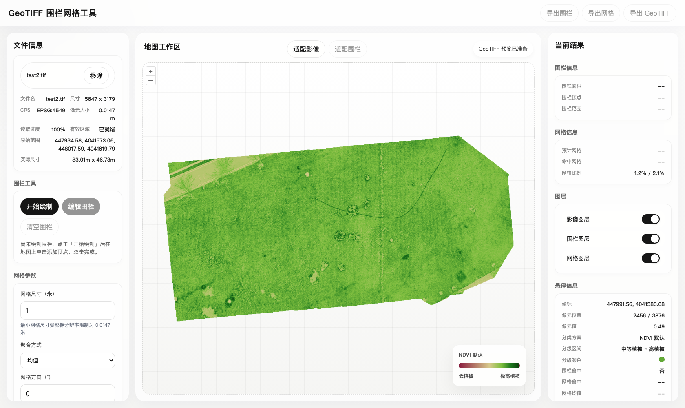

# GeoTIFF 围栏网格工具

**中文** · [English](README.en.md)

面向精准农业作业的浏览器端 Web 工具：加载 GeoTIFF 遥感影像，在地图上绘制电子围栏、生成空间网格、按网格聚合像元值，并导出可直接下发到农机终端的 GeoJSON 与处方 GeoTIFF。影像全程在本机解析，不上传服务器。


## 目录

- [界面预览](#界面预览)
- [核心特性](#核心特性)
- [典型业务流程](#典型业务流程)
- [技术栈](#技术栈)
- [快速启动](#快速启动)
- [项目结构](#项目结构)
- [模块速览](#模块速览)
- [性能](#性能)
- [测试](#测试)
- [常见问题](#常见问题)
- [开发路线](#开发路线)
- [许可](#许可)

## 界面预览

### 完整工作流：围栏 + 网格 + 聚合结果


左侧配置网格尺寸、方向与分类方案，中间地图同时呈现影像、围栏轮廓与网格着色，右侧实时给出围栏面积、命中网格数与悬停像元/网格均值。

<details>
<summary>更多截图</summary>

### 启动界面


| 影像加载完成 | 结果与悬停信息 |
| --- | --- |
|  |  |


</details>

## 核心特性

- **GeoTIFF 加载与解析**：本地读取大尺寸影像；自动提取 CRS、分辨率、边界框与波段数；预览优先渲染，有效数据掩码异步提取。
- **电子围栏**：在地图上绘制、编辑、清空多边形围栏；自动裁剪到影像边界与有效数据范围并给出校验提示；输出面积、顶点数与范围。
- **空间网格与聚合**：按物理尺寸实时划分网格，支持旋转与均值/最大/最小值聚合；以网格中心命中规则筛选；最小网格尺寸受影像分辨率限制；网格预览、悬停信息与导出结果共用同一份聚合数据。
- **分类与变量施肥**：单波段影像支持规则分段与渐变着色，多套方案可新建、复制、切换与显隐，内置 NDVI 默认方案；每条规则可配置颜色、标签与用量，并按分类汇总覆盖面积与预计总用量。
- **导出**：围栏/网格 GeoJSON（含聚合值与 `fertilizerAmount`）；按围栏裁剪的处方 GeoTIFF —— 网格聚合值回写像元、未命中区域写 NoData、启用规则时追加处方波段，默认 Deflate 压缩。
- **大文件可用性**：文件解析与重计算都在 Web Worker 中完成，Worker 不可用时回退主线程；数万级网格用 WebGL 渲染，超出上限时仅采样渲染（悬停与导出仍覆盖全部网格）。

## 典型业务流程

1. 在左侧面板选择 GeoTIFF 文件，系统解析元信息并生成地图预览。
2. 点击「开始绘制」，在地图上单击添加顶点，回到起点（或双击）闭合围栏；围栏自动裁剪到有效数据范围。
3. 配置网格尺寸与方向（可选：切换分类方案与施肥用量），系统实时生成网格预览并完成像元聚合。
4. 地图与右侧面板同步展示网格统计、分类结果与处方量估算；悬停可查看像元值、分类区间与网格均值。
5. 通过顶栏导出围栏 GeoJSON、网格 GeoJSON 或裁剪后的处方 GeoTIFF。

## 技术栈

| 分类 | 选型 |
| --- | --- |
| 框架 | React 19 + TypeScript + Vite 6 |
| 状态管理 | Zustand 5 |
| 地图渲染 | OpenLayers 10（网格层走 WebGL） |
| 栅格解析 | geotiff.js |
| 空间计算 | Turf.js + Proj4js |
| 测试 | Vitest + Testing Library |

## 快速启动

环境要求：Node.js 18+、pnpm。

```bash
pnpm install    # 安装依赖
pnpm dev        # 启动开发服务器
```

默认访问 <http://localhost:5173>。开发服务器仅监听本机回环地址，如需局域网访问可自行追加 `--host`。

准备一个本地 GeoTIFF（含 `GDAL_NODATA` 或 0 值背景的单波段/多波段影像均可），在左侧「文件信息」中点击「选择 TIFF 文件」加载。

### 可用脚本

| 命令 | 说明 |
| --- | --- |
| `pnpm dev` | 启动 Vite 开发服务器 |
| `pnpm build` | 类型检查（`tsc --noEmit`）+ 生产构建 |
| `pnpm preview` | 预览生产构建产物 |
| `pnpm test` | 运行全部 Vitest 测试 |

## 项目结构

```text
src/
├── app/                  # 三栏布局、样式与渲染入口
├── features/
│   ├── map/              # 地图实例、图层、加载链路与交互
│   ├── fence/ grid/      # 围栏与网格状态
│   ├── export/           # GeoJSON / GeoTIFF 导出
│   ├── project/          # 工程快照与草稿
│   └── loading/          # 全局加载状态
└── shared/
    ├── geo/              # 纯地理计算：CRS、围栏、网格、聚合、GeoTIFF 读写
    ├── workers/          # Worker 任务、请求构造与注册表
    └── hooks/ types/     # 通用 Hook 与类型契约

tests/                    # 单元 / 组件测试（bench/ 为聚合等价性基准）
docs/                     # 设计文档、性能调研与截图
```

## 模块速览

| 模块 | 职责 | 主要实现 |
| --- | --- | --- |
| 栅格接入 | 文件选择、元信息解析、预览与有效区域 | [rasterIo.ts](src/shared/geo/rasterIo.ts)、[useRasterLoader.ts](src/features/map/useRasterLoader.ts) |
| 地图工作区 | 影像/围栏/网格渲染、视口适配、悬停反馈 | [useMap.ts](src/features/map/useMap.ts)、[useFenceInteractions.ts](src/features/map/useFenceInteractions.ts)、[mapUtils.ts](src/features/map/mapUtils.ts) |
| 围栏 | 绘制、编辑、校验、裁剪与摘要 | [fence.ts](src/shared/geo/fence.ts) |
| 网格与聚合 | 网格生成、旋转、像元聚合与 O(1) 命中 | [grid.ts](src/shared/geo/grid.ts)、[gridAggregation.ts](src/shared/geo/gridAggregation.ts) |
| 分类与处方 | 规则/渐变着色、用量映射与统计 | [rasterClassification.ts](src/shared/geo/rasterClassification.ts)、[applicationRate.ts](src/shared/geo/applicationRate.ts) |
| 导出 | 围栏/网格 GeoJSON、处方 GeoTIFF | [geoTiffExportJob.ts](src/features/export/geoTiffExportJob.ts)、[geotiffWriter.ts](src/shared/geo/geotiffWriter.ts) |
| 工程快照 | 配方契约与序列化、校验、还原与本地草稿 | [projectSnapshot.ts](src/features/project/projectSnapshot.ts)（契约）、[projectSnapshotSchema.ts](src/features/project/projectSnapshotSchema.ts)（校验）、[draftStorage.ts](src/features/project/draftStorage.ts) |
| 后台计算 | Worker 任务、窗口解码缓存、注册表 | [rasterWorkerTasks.ts](src/shared/workers/rasterWorkerTasks.ts) |

分层约定：`app` 负责布局与入口编排，`features` 承载业务状态与流程，`shared/geo` 是无 UI 依赖的计算层，`shared/workers` 只放可 offload 的纯任务。

例外一条，改动时请注意：`shared/workers` 是组装层，允许反向依赖 `features` 中被 Worker 复用的纯逻辑 ——
`rasterWorkerTasks.ts` 会调用 `features/export/geoTiffExportJob.ts` 与 `features/project/readEmbeddedSnapshot.ts`，
`rasterWorkerRequests.ts` 引用 `features/project/projectSnapshot.ts` 的类型。
也就是说 `shared/geo` 保持无反向依赖，但 `shared/workers` 不是——修改 `features/export` 或 `features/project` 的快照契约会影响 Worker。

## 性能

以下数字来自真实影像（5647×3179）与本机 Chromium 的实测，脚本见 [tests/bench](tests/bench/grid-aggregation.test.ts)：

| 环节 | 优化前 | 现在 |
| --- | --- | --- |
| 网格聚合（4.49M 像元窗口） | 403–447 ms | **6.4–8.5 ms** |
| 单次调参（改尺寸/旋转/聚合模式） | ~375 ms（每次重新解码整窗） | **~13 ms**（命中解码缓存） |
| 导出体积（2.56M 像元处方图） | 49.3 MB | **0.13 MB**（Deflate） |
| 导出主线程占用 | 约 0.5 s 冻结 | **0**（Worker 内完成） |
| 5.46 万格平移缩放（89 次输入事件） | 主线程 1.7 s / 脚本 1.57 s | **主线程 0.28–0.64 s / 脚本 0.09–0.32 s** |
| 大文件内存 | 每个线程常驻一份全量文件缓冲 | 有界 LRU（最多 2 个影像），主线程不再读文件 |

最后一行为同一段拖拽+缩放脚本的主线程 CPU（自动化窗口会被系统节流，墙钟不可用）；网格数超过渲染上限时地图按采样渲染，因此该项同时包含渲染方式与采样策略的收益。

做法要点：

- **聚合**：按网格列把像素列合并成区间后逐区间累加，配合 `Float64Array` 求和与 `Uint32Array` 计数、行列表查度量坐标，取代逐像元的度量计算、除法与字符串键查找。
- **解码**：围栏窗口在 Worker 内按窗口缓存（LRU 2 个窗口），网格参数变化不再重复解码。
- **渲染**：网格层用 OpenLayers `WebGLVector`（配色写在要素属性上），超出 5 万格时降采样渲染，悬停查表仍用全量。
- **导出**：Float32 直出 + 单次组装 TIFF 缓冲，用原生 `CompressionStream` 做 Deflate 压缩，不可用时自动退回不压缩。
- **内存**：`RasterSession` 按内容指纹键控并设 LRU 上限；元信息与内嵌配方读取下沉 Worker，主线程不再持有整文件缓冲。

同类方案、论文与后续建议见 [docs/raster-zonal-stats-perf-brief.md](docs/raster-zonal-stats-perf-brief.md)。

## 测试

```bash
pnpm test    # 运行全部测试
```

覆盖空间计算（CRS、围栏、网格、聚合、度量变换、GeoTIFF 写入与导出）、状态管理、工程快照与草稿，以及主要界面交互。Worker 任务实现与线程包装分离，可直接单测聚合、元信息、内嵌配方与导出路径。

[tests/bench/grid-aggregation.test.ts](tests/bench/grid-aggregation.test.ts) 保留了一份旧写法的对照实现，用随机参数（含旋转、洞环、地理 CRS、负分辨率、nodata）校验聚合内核与波段回填逐单元格一致，并输出耗时对比。

CI（[.github/workflows/ci.yml](.github/workflows/ci.yml)）在 Node.js 22 + pnpm 10 上执行 `pnpm install --frozen-lockfile`、`pnpm build` 与 `pnpm test`。

## 常见问题

**围栏提示「围栏必须落在影像有效数据范围内」怎么办？**
把围栏画在有效数据区域内（避开透明/nodata 边缘）。可先点「适配影像」定位，再沿有效区域内部绘制。

**网格数量为 0 或没有着色？**
检查网格尺寸是否远大于围栏尺寸，以及围栏是否与有效数据有交集。悬停时「网格命中」为 `--` 说明该位置没有命中网格。

**网格数量很多时地图只显示一部分格子？**
超过 5 万格时地图按步长采样渲染，右键提示会给出实际采样数量；悬停与导出仍覆盖全部网格，结果不受影响。

**导出的 GeoTIFF 为什么是 `Float32`？**
启用分类规则后需要写入施肥量处方波段，因此波段统一提升为 `Float32`；未启用时尽量保留原始数据类型。

**导出的文件为什么比源影像小很多？**
处方图每个网格是同一个值，像元重复度极高。写出时默认用 Deflate 压缩（TIFF `Compression=8`），实测可把 49 MB 压到 0.1 MB 量级；运行环境没有 `CompressionStream` 时自动退回不压缩，取值完全一致，只是更大。

**浏览器卡顿或页面无响应？**
优先确认影像尺寸与网格密度。对超大网格只做采样渲染，但仍建议避免极端参数组合。

## 开发路线

已支持：三栏工作台与地图集成、GeoTIFF 解析与渲染、围栏绘制/编辑/裁剪、网格旋转与聚合、分类图层与用量估算、围栏/网格 GeoJSON 与处方 GeoTIFF 导出、工程快照保存/打开与内嵌配方、植被指数面板、多坐标系检测与投影转换、Worker 化的解析与计算、大网格 WebGL 渲染。

计划中：

- [ ] 多围栏队列与批量导出
- [ ] 超大影像的分块读取与更细粒度的内存上限
- [ ] 在线影像（COG / HTTP Range）支持
- [ ] 导出可选不压缩，用于只识别未压缩 TIFF 的终端

## 许可

本项目基于 [MIT License](LICENSE) 发布，Copyright (c) 2026 ttot contributors。
